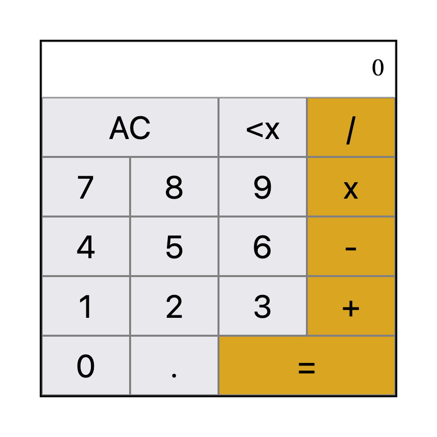

# Calculator

A basic calculator built with JavaScript, usable with the mouse or the keyboard.

🔗 **[Online demo](https://ikab08.github.io/calculator/)**

## Features
- Addition, subtraction, multiplication and division
- Chained operations evaluated one single pair at time
- Division by zero handled with an error message
- Results rounded to aivoid long decimals
- "Clear" button to reset and "backspace" button to erase the last digit
- Keyboard support

## Technologies
HTML, CSS, JavaScript

## Run locally
Clone the repository, then open `index.html` in your browser.